# agent-memory 客户端使用说明（图解版）

> 这份文档只讲**桌面客户端**（`agent-memory-app.exe`）：怎么装、怎么开、每个页面点哪里、
> 每个设置改了会发生什么。全程不需要敲命令。
> 命令行与 HTTP API 的说明在 [docs/usage.md](usage.md)，本文只在必要处引用。
>
> 文中截图全部来自本机真实运行环境的桌面窗口（10 个项目 / 250 条记忆 / 50+ 条任务），
> 图上的**虚线框 + 蓝色序号**就是下面列表里的编号，按号对照即可。

---

## 目录

1. [它到底帮你做什么](#1-它到底帮你做什么)
2. [安装](#2-安装)
3. [第一次启动：发生了什么](#3-第一次启动发生了什么)
4. [窗口、托盘与"关掉窗口之后"](#4-窗口托盘与关掉窗口之后)
5. [总览页](#5-总览页)
6. [记忆档案页](#6-记忆档案页)
7. [编辑一条记忆](#7-编辑一条记忆)
8. [项目档案页](#8-项目档案页)
9. [来源页](#9-来源页)
10. [任务页：对话任务与合并任务](#10-任务页对话任务与合并任务)
11. [任务详情页：步骤、片段与交接](#11-任务详情页步骤片段与交接)
12. [新建任务](#12-新建任务)
13. [MCP 接驳台：让每个 agent 接上同一份记忆](#13-mcp-接驳台让每个-agent-接上同一份记忆)
14. [设置中心](#14-设置中心)
15. [数据放在哪里](#15-数据放在哪里)
16. [三个典型工作流](#16-三个典型工作流)
17. [故障排查](#17-故障排查)
18. [安全与边界](#18-安全与边界)
19. [常见问题](#19-常见问题)
20. [附录：维护者如何出安装包](#附录维护者如何出安装包)

---

## 1. 它到底帮你做什么

你在 Qoder、Trae、WorkBuddy、OpenCode、Claude Code 之间来回切换。每换一个，就得重新交代一遍：
这个项目是什么、你偏好什么、上次做到哪了。

agent-memory 做三件事：

| 能力 | 说明 | 你要做什么 |
| --- | --- | --- |
| **收** | 定时扫描各 agent 存在本机的记忆文件与会话记录，归一化进一个本地 SQLite 库 | 什么都不用做，装完自动跑 |
| **理** | 中文分词、去重合并、判断过时；把每次 agent 对话整理成一条"对话任务"（含步骤与片段），再按需合并成跨对话的任务 | 想纠错时在客户端里改 |
| **给** | 通过 MCP 把同一份记忆回喂给每个 agent；通过交接简报（`HANDOFF.md`）喂给"下一个接手的人" | 在 MCP 接驳台点一次复制 |

数据**只存在你自己电脑上**，服务只监听 `127.0.0.1`，不会上传任何东西（除非你自己在设置里接了 LLM 摘要，见 [14.2](#142-llm-摘要可选)）。

---

## 2. 安装

### 2.1 用安装包（推荐）

双击 `agent-memory-setup-x64.exe`：

1. 欢迎页 → **下一步**
2. 位置页：默认 `%LOCALAPPDATA%\Programs\agent-memory`，**不需要管理员权限**，建议不改
3. 安装 → 完成页勾选 **启动 agent-memory**

装完你会得到：

- 桌面快捷方式 **agent-memory 共享记忆**（启动参数已带 `--tray-only`，双击直接进托盘）
- 开始菜单文件夹 `agent-memory\`，里面有：程序本体、**使用说明**、**卸载**
- 注册表卸载项（控制面板 → 程序和功能 里能看到 `agent-memory 共享记忆`）

> **卸载不会删数据。** 卸载页会明确提示 `~\.agent-memory` 保留；想彻底清掉，自己在卸载后删这个目录。

### 2.2 不装，直接跑

拿到 `agent-memory-app.exe` + `agent-memory.exe` 两个文件，放任意目录，双击前者即可。
两者要放在**同一个目录**（桌面程序会用自己的路径去注册 MCP 启动程序）。

### 2.3 换过安装位置之后

如果你从"绿色版目录"改成"安装包目录"（或反过来），**MCP 里登记的启动程序路径会失效**。
处理办法只有一处：设置 → 服务与托盘 → **MCP 启动程序**，填新路径并保存，
程序会自动重写所有已登记客户端（Qoder / OpenCode / Claude Code）的配置文件，见 [14.1](#141-服务与托盘)。

---

## 3. 第一次启动发生了什么

双击图标后 3 秒内，按顺序发生：

1. **建数据目录** `C:\Users\<你>\.agent-memory\`，写入默认 `config.toml`
2. **建库** `memory.db`（SQLite，WAL 模式，单连接，纯 Go 驱动，不需要 VC++ 运行库）
3. **生成访问令牌** `token`（随机串，是本机 API 的口令，别外传）
4. **拉起内置服务** 在 `127.0.0.1:47123` 起 HTTP 服务（作为子进程，**关掉窗口也继续活着**）
5. **打开 WebView2 窗口** 显示总览页；同时在系统托盘放一个 `AM` 图标
6. **首轮扫描** 后台扫描已发现的 agent 目录，扫完页面数字就会变

窗口标题固定为 `agent-memory 共享记忆`。如果提示缺少 WebView2 运行时，见 [17](#17-故障排查)。

---

## 4. 窗口、托盘与"关掉窗口之后"

**托盘图标右键菜单**（这是客户端最重要的一个入口）：

| 菜单项 | 作用 |
| --- | --- |
| 打开界面 | 重新唤出主窗口（窗口已关也能唤回） |
| 立即同步 | 马上跑一轮扫描，不等定时器 |
| 打开日志 | 用记事本打开 `~\.agent-memory\app.log` |
| 开机自动运行 | 勾选/取消登录自启（写 `HKCU\...\Run`，带 `--tray-only`） |
| 停止服务并退出 | 结束托盘程序 **并** 关掉本地服务（MCP 会同时断开） |

三条必须知道的行为：

- **单实例**：程序用命名互斥保证只跑一个。已经开着的时候再双击图标，**不会**开第二个，而是把已有窗口叫到前台。
- **关窗 ≠ 退出**：默认"关闭窗口后保持托盘运行"是开着的。点 × 只是收进托盘，服务继续给 agent 供记忆。
- **想真退出**：用托盘菜单的"停止服务并退出"，别用任务管理器杀进程（会留下 `port`/`token` 之外的临时文件，下次启动会自愈，但没必要）。

---

## 5. 总览页

总览页是打开客户端的第一屏，从上到下四块：**顶栏 → 主张 → 数字 → 项目索引 → 用户级记忆 → 快速添加**。

### 5.1 顶栏与首屏


| 号 | 位置 | 说明 |
| --- | --- | --- |
| 1 | 主导航 | 总览 / 记忆档案 / 任务 / MCP / 设置 / 来源，当前页高亮 |
| 2 | 服务状态 | `正常 · <版本>` 表示本地服务可达且令牌有效；变红时看 [17](#17-故障排查) |
| 3 | 主题切换 | 深色/浅色一键切换，选择会记住，见 [5.5](#55-浅色主题) |
| 4 | 立即同步 | 手动跑一轮扫描，完成后自动刷新页面；等价于托盘菜单同名项 |
| 5 | 主张区 | 纯展示，说明这台机器上有哪些 agent 的记忆被收进来了 |
| 6 | 数字磁贴 | **每个数字都能点**，直接跳到对应的明细页 |
| 7 | 任务磁贴 | 未归档任务总数（对话任务 + 合并任务），点进去是任务页 |

五个磁贴的去处：`项目`→本页项目索引、`记忆`→记忆档案、`过时`→记忆档案（含过时）、`来源`→来源页、`任务`→任务页。

> 这一格以前是「失败源」，正常机器上恒为 0，看不出任何东西，所以换成了任务数。
> 解析失败的来源仍然在**来源页**用「只看失败」筛出来，没有丢功能。

### 5.2 项目索引

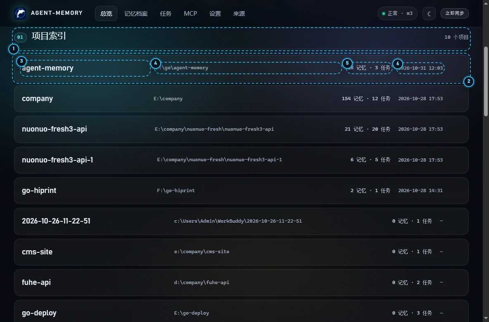

| 号 | 位置 | 说明 |
| --- | --- | --- |
| 1 | 分区标题 | `01 项目索引` + 右侧项目总数 |
| 2 | 一行 = 一个项目 | 整行可点，进入项目档案页 |
| 3 | 项目名 | 来自目录名或 git 仓库名 |
| 4 | 绝对路径 | 这个项目在你电脑上的位置 |
| 5 | 计数 | `N 记忆 · M 任务`，一眼看出这个项目沉淀了多少 |
| 6 | 最后更新时间 | `—` 表示只登记了任务、还没有记忆条目 |
| 7 | 箭头 | 与整行同义，点它进项目档案 |

### 5.3 用户级记忆

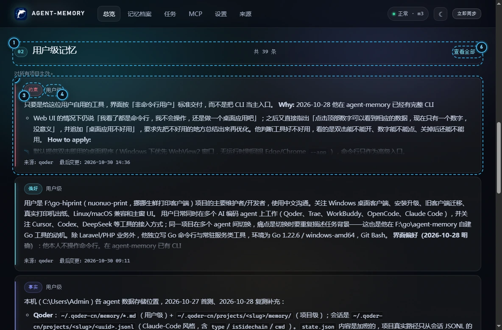

| 号 | 位置 | 说明 |
| --- | --- | --- |
| 1 | 分区标题 | `02 用户级记忆` + 总条数 |
| 2 | 一条记忆 | 整卡可点，进入编辑页；这里只显示前几条 |
| 3 | 类型章 | 六种类型：**偏好 / 约束 / 约定 / 教训 / 事实 / 目标**，颜色不同 |
| 4 | 范围 | `用户级` = 对所有项目生效；`项目级` 会显示所属项目 |
| 5 | 正文 | Markdown 渲染后的内容，超长折叠 |
| 6 | 查看全部 | 跳到记忆档案页（自动带上当前范围筛选） |

### 5.4 快速添加与页脚

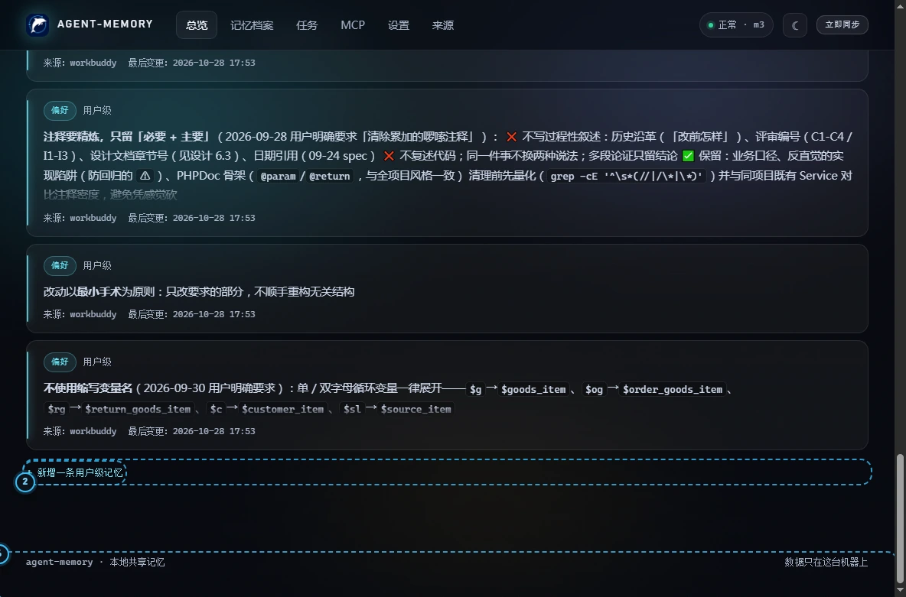

| 号 | 位置 | 说明 |
| --- | --- | --- |
| 1 | 添加面板 | 「新增记忆」整块，默认折叠 |
| 2 | 折叠标题 | 点一下展开表单 |
| 3 | 正文 | 支持 Markdown，写一条**可复用**的偏好/约束/事实，别写一次性上下文 |
| 4 | 类型 | 下拉选六类之一 |
| 5 | 保存 | 写进用户级范围；保存后这条会进入摘要队列（若已启用 LLM） |
| 6 | 页脚 | 显示服务版本与本机数据位置 |

> 项目级记忆要到**项目档案页**里加（见 [8](#8-项目档案页)），总览页这里只加用户级。

### 5.5 浅色主题


| 号 | 位置 | 说明 |
| --- | --- | --- |
| 1 | 主题切换 | 顶栏的 ◐ 按钮，深浅色即时切换并记住 |
| 2 | 数字磁贴 | 浅色下同样可点下钻 |
| 3 | 项目行 | 列表在两种主题下布局完全一致 |

---

## 6. 记忆档案页

这里是"翻旧账"的地方：所有项目 + 用户级的记忆都在一张列表里，可以按关键词、范围、项目、类型筛。

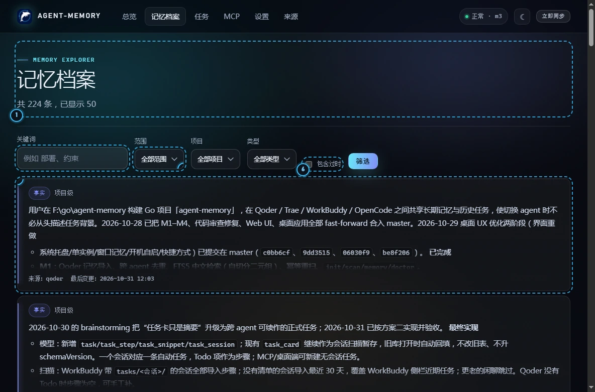

| 号 | 位置 | 说明 |
| --- | --- | --- |
| 1 | 页头 | 显示 `共 N 条，已显示 M` —— M 是当前已加载条数 |
| 2 | 关键词 | 中文按词匹配，不是死板包含；例如 `部署`、`约束`、`中文检索` |
| 3 | 范围 | 全部 / 用户级 / 项目级 |
| 4 | 项目 | 只看这个项目（与「范围」叠加使用；从项目档案页跳过来时会自动带上"项目级"） |
| 5 | 类型 | 六类之一 |
| 6 | 包含过时 | 默认**不显示**已过时条目；勾上才会一起列出来 |
| 7 | 筛选 | 提交条件（条件会写进地址栏，所以这一屏可以收藏/回退） |
| 8 | 结果条目 | 与总览页同一种卡片，点进编辑页 |

**关键词怎么搜最有效**：搜"结论里的词"而不是"你想问的句子"。
比如想找那条关于界面标准的约束，搜 `桌面` 或 `命令行` 比搜"我对界面有什么要求"命中得更准。

---

## 7. 编辑一条记忆

从任何一条记忆点进来都是这个页面。左边改，右边立刻看到渲染结果。

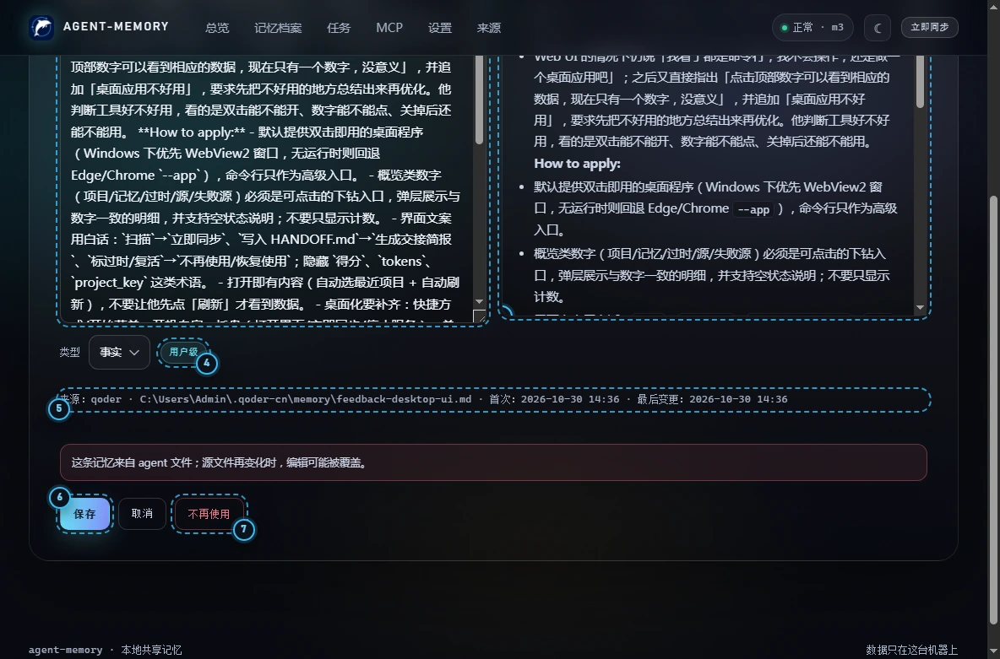

| 号 | 位置 | 说明 |
| --- | --- | --- |
| 1 | 正文（Markdown） | 直接改，改完必须点保存 |
| 2 | 实时预览 | 边打边渲染，标题/列表/代码块/加粗都支持 |
| 3 | 类型 | 可以改类别，比如把"事实"改成"约束" |
| 4 | 范围章 | 显示这条属于哪个项目或"用户级"（范围本身不可改，要换范围就新写一条） |
| 5 | 元信息 | 来源 agent、来源文件、首次写入时间、最后变更时间 |
| 6 | 保存 | 保存会**合并去重**：如果新正文与已有条目实质相同，不会产生两条 |
| 7 | 不再使用 | 把这条标记为**过时**：列表默认不再显示，但历史保留，随时可取消 |

> 顶部面包屑 `总览 / 记忆档案 / 编辑` 可以点回上一页。
> 如果启用了 LLM 摘要，正文上方会多出一张「AI 摘要」卡片（长条文的短版结论）。

---

## 8. 项目档案页

点总览页的项目行进来。左侧一条竖栏（项目身份 + 页内导航），右侧七个分区。

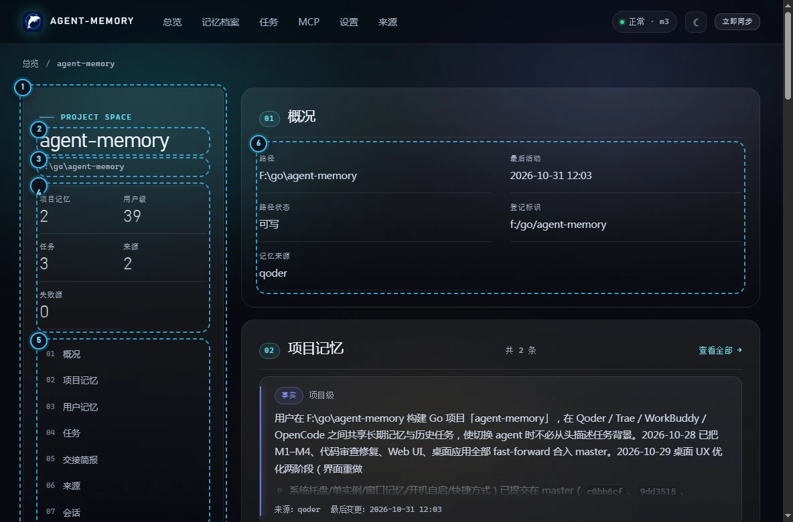

| 号 | 位置 | 说明 |
| --- | --- | --- |
| 1 | 竖栏 | 项目身份区，宽屏下常驻 |
| 2 | 项目名 | 大标题 |
| 3 | 绝对路径 | 等宽字体，方便核对是不是同一个目录 |
| 4 | 关键指标 | 项目记忆 / 用户级 / 任务 / 来源 / 失败源 五个计数 |
| 5 | 页内导航 | 01 概况 / 02 项目记忆 / 03 用户记忆 / 04 任务 / 05 交接简报 / 06 来源 / 07 会话，点了直接滚到那一段 |
| 6 | 概况 | 四格：路径、最后活动、路径状态（可写/不存在）、登记标识（project_key） |

> 竖栏下方若出现红字提示「项目路径不存在：项目级写入与生成简报已禁用」，说明这个目录已被移动或删除，
> 此时「新增项目记忆」和「生成交接简报」都会置灰。

往下滚到交接简报：

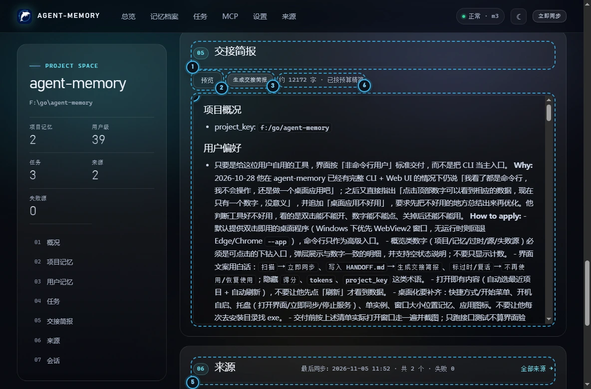

| 号 | 位置 | 说明 |
| --- | --- | --- |
| 1 | 分区标题 | `05 交接简报` |
| 2 | 预览 | 只在页面上显示拼装结果，**不写文件** |
| 3 | 生成交接简报 | 真正写入 `<项目>\.agent-memory\HANDOFF.md` |
| 4 | 简报正文 | 固定五段：`项目概况` → `用户偏好` → `项目硬约束与约定` → `进行中的任务`（或降级为`最近任务`）→ `未决问题`，末尾附`共享记忆入口` |
| 5 | 来源分区 | 下面紧接 `06 来源`，列出这个项目对应的记忆与会话文件 |
| 6 | 状态行 | 上次生成的时间与字节数 |

**为什么要"预览"和"生成"两个按钮**：预览随便点，不碰磁盘；生成才会落地文件。
`HANDOFF.md` 是这个项目给任何 agent 的"接手简报"——`agents.md` 里那句"接手前先读 `.agent-memory/HANDOFF.md`"就是靠它生效的。
生成时程序会自动把 `.agent-memory/` 加进 `.git/info/exclude`，不会污染仓库。

---

## 9. 来源页

"来源"= 程序实际读过的那些文件：各 agent 的记忆 Markdown、会话 JSONL、WorkBuddy 的 MEMORY/Todo。
排查"为什么某条记忆没进来 / 为什么过时了"，第一站就是这里。

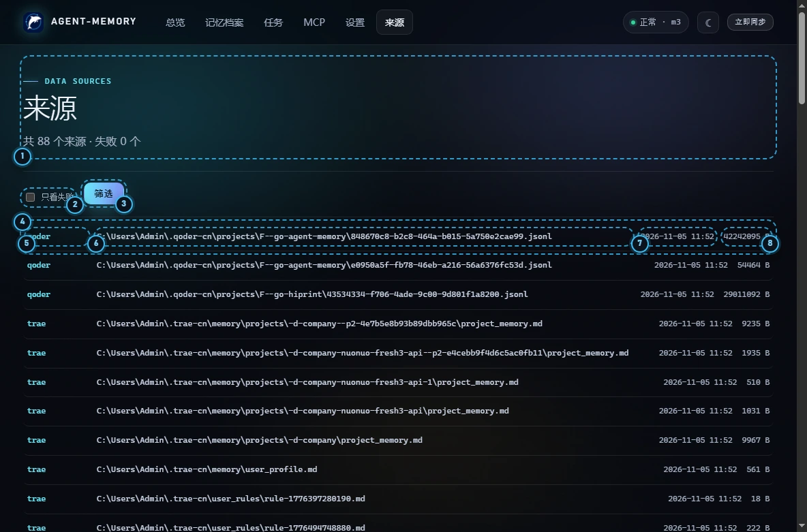

| 号 | 位置 | 说明 |
| --- | --- | --- |
| 1 | 页头 | 说明文字 + 来源总数 |
| 2 | 只看失败 | 只列出解析出错的文件（格式不认识、读不到等） |
| 3 | 筛选 | 提交上面的开关 |
| 4 | 一行 = 一个来源 | 按最后扫描时间倒序 |
| 5 | agent 章 | `qoder` / `trae` / `workbuddy` |
| 6 | 文件绝对路径 | 等宽显示，能直接复制去核对 |
| 7 | 最后扫描时间 | 每次扫描成功读到该文件都会刷新 |
| 8 | 文件大小 | 突然变成 0 B 或明显变小，就是源头被动过 |

> 来源是**只读**的：程序永远不会写这些文件，最多因为"这次没扫到"而把对应记忆判成过时。

---

## 10. 任务页：对话任务与合并任务

任务是这套东西里最"活"的部分。它有两种，任务页用「视图」下拉切换：

| 视图 | 一条任务 = | 从哪来 | 步骤从哪来 |
| --- | --- | --- | --- |
| **对话任务** | 某个 agent 里的一次对话 | 扫描自动产出，一次会话一条 | agent 自己的 Todo（WorkBuddy）或从那次对话整理出来 |
| **合并任务**（默认视图里也在） | 跨几次对话的一件事 | 你在「新建任务」里手建，或 agent 通过 MCP 建，或由对话任务「合并到…」得到 | 你自己写，或合并时并进来 |

默认视图是**全部**，两类一起按「最近对话」排——这样 agent 通过 MCP 新建的合并任务不会一进来就被藏起来。
想看"哪个 agent 的哪次对话做到哪一步"就把视图切到**对话任务**；交接简报优先引用的是整理过的**合并任务**（见 [8](#8-项目档案页)）。

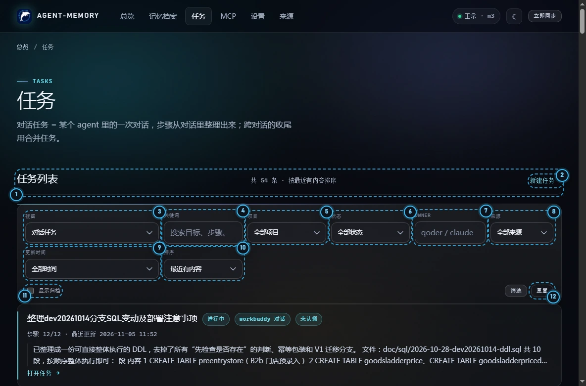

| 号 | 位置 | 说明 |
| --- | --- | --- |
| 1 | 列表标题 | `任务列表` + 命中条数 + **当前排序方式**（例如"按最近对话排序"） |
| 2 | 新建任务 | 进空白任务表单，建出来的是合并任务，见 [12](#12-新建任务) |
| 3 | 视图 | **全部**（默认，两类一起排）· 对话任务 · 合并任务 |
| 4 | 关键词 | 搜目标、步骤、下一步、文件名 |
| 5 | 项目 | 只看某个项目 |
| 6 | 状态 | 进行中 / 受阻 / 已完成 / 未知 |
| 7 | Owner | 谁认领了这条任务，例如 `qoder` |
| 8 | 来源 | 任务是哪个 agent 的：Qoder / Trae / WorkBuddy / 手动 / MCP |
| 9 | 更新时间 | 最近 7 / 30 / 90 天 |
| 10 | 排序 | **最近对话**（默认，关联会话的最新时间）· 最近创建 · 最久没动 |
| 11 | 显示归档 | 默认不显示归档任务，勾上才列出来 |
| 12 | 重置 | 清空全部条件回到默认视图 |

> **筛完立刻出结果**：任何一项一改就重新查询，不用再点「筛选」；地址栏同步更新，
> 所以浏览器前进/后退和复制链接都还有效。文本框有约 0.4 秒防抖，边打字边筛不会卡。
> 排序默认「最近对话」：以那次 agent 对话的时间为准，最近聊过的任务排在最前。
> 卡片上的「最近更新」是这条记录最后一次被写入的时间（扫描也会刷它），所以列表顺序和它不一致是正常的。

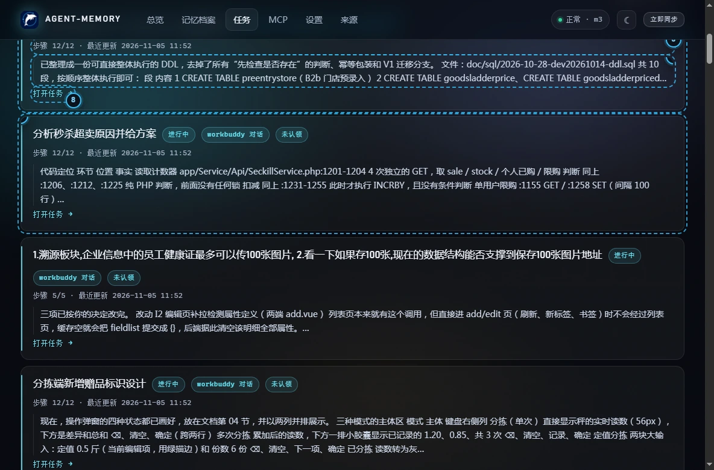

| 号 | 位置 | 说明 |
| --- | --- | --- |
| 1 | 一张任务卡 | 点标题进入详情 |
| 2 | 任务标题 | 即"目标"的第一句（对话任务用的是那次对话的标题） |
| 3 | 状态章 | 进行中（蓝）/ 受阻（红）/ 已完成（绿）/ 未知（灰） |
| 4 | 类型章 | `workbuddy 对话` = 对话任务并带来源 agent；`合并任务` = 跨对话整理的那类 |
| 5 | 认领章 | `未认领` 或当前 owner；agent 通过 MCP 认领后会变 |
| 6 | 元信息 | 步骤进度 · 最近更新（对话任务的 agent 已在类型章里，不再重复） |
| 7 | 摘要片段 | 下一步或 AI 摘要的压缩版，扫一眼就知道做到哪 |
| 8 | 打开任务 | 进详情页 |
| 9 | 下一张卡 | 按所选排序排列 |

---

## 11. 任务详情页：任务头 + 四个区

详情页分两层：**顶部常驻任务头**（改目标/状态/owner/下一步）+ **四个 tab**（最近对话 / 进行中的 task / 任务文件 / 任务交接）。
进来默认停在「最近对话」，因为接手时最先想知道的是“这场对话最近干到哪了”。

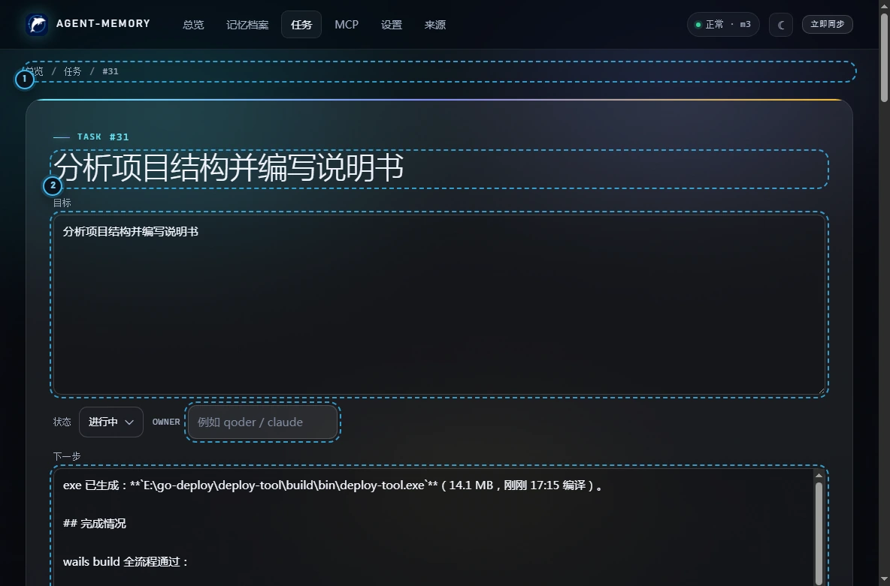

| 号 | 位置 | 说明 |
| --- | --- | --- |
| 1 | 目标 | 这条任务要达成什么；点击即改，保存后才会写回 |
| 2 | 状态 / owner | 状态四态之一（改了不再冻结扫描同步）；owner 留空即未认领 |
| 3 | 下一步 | 接手者该做的第一件事，保存后同时进交接简报 |

下面一行是元信息（对话任务/合并任务 · 来源 · 最近更新 · 是否归档）与操作：保存 / 归档 / 合并到… / 复制完整交接 / 返回。

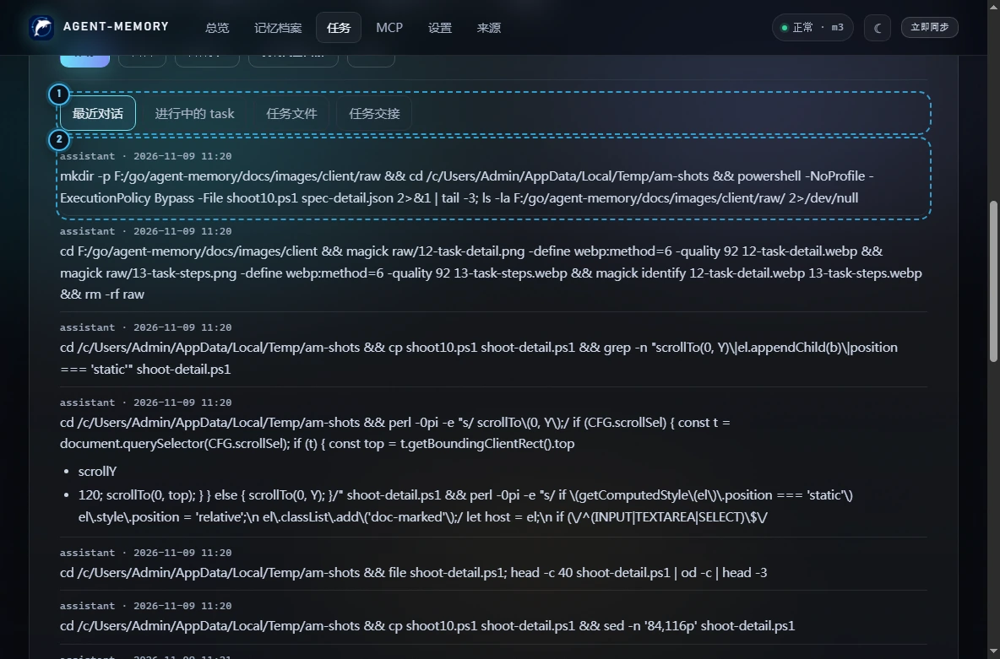

| 号 | 位置 | 说明 |
| --- | --- | --- |
| 1 | tab 栏 | 最近对话 / 进行中的 task / 任务文件 / 任务交接；切换会写进地址栏 `?tab=`，刷新与前进后退保持 |
| 2 | 一条消息 | 角色 + 时间 + Markdown 正文；工具调用折成一行，库里截断的条目尾部标「…源文件里更长」 |

**最近对话**：**最新的在最上面**，往下越早；点「加载更早」把更早的消息接在列表底部，按 seq 游标往前翻，到会话开头会提示。完整对话在 agent 每次回复落盘后自动入库（用户/助手全文，工具只留命令/文件摘要与报错），所以源文件改名或删掉也能继续看；旧库还没写入完整对话时回退读源文件并在顶部提示。下方「来源会话」列出关联的 agent、标题与最近活动。

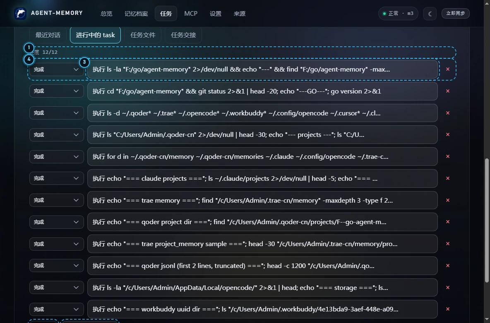

| 号 | 位置 | 说明 |
| --- | --- | --- |
| 1 | 进度 | 已完成+已跳过的步骤数 / 总数 |
| 2 | 一行步骤 | agent Todo（Qoder 的 TaskCreate/TaskUpdate、WorkBuddy 的清单）或从对话整理出来的步骤 |
| 3 | 步骤状态 | **稳定 key 的步骤**改了立即生效、不冻结扫描；反推步骤（`cmd:` 开头）不能单独改状态 |
| 4 | 步骤文本 | 编辑文本或增删步骤要按「保存步骤（接管同步）」，之后这条任务不再由扫描自动更新 |

**任务文件**：按文件聚合这场对话（含合并任务关联的多场会话）的 `tool_edit` 事件——路径、最近改动时间、改动次数、来源 agent，按最近时间倒序；顶部可一键复制全部路径。手工建的合并任务没有会话事件时退回任务记录里的文件清单。

**任务交接**：上半是**极简接手版**（目标 / 现在到哪卡在哪 / 未完成步骤 / 关键文件 ≤8 个 / 三行指令，约 30 行内），一键复制；下面折叠「完整版（命令/报错/片段）」。把复制的 Prompt 粘给下一个 agent，它会先 `task_get` 再用同一个 `task_id` 更新。

> **改对话任务要注意**：改状态、owner、下一步**不会**冻结扫描——扫描照常把对话里的新步骤同步进来，人工状态在展示时叠加。
> 只有改**目标**或**整组步骤文本**才算人工接管，之后扫描只更新片段、不再重写目标与步骤。

---

## 12. 新建任务

「新建任务」建出来的是**合并任务**：跨几次对话的一件整体的事，由你自己写目标、步骤与下一步。
每次对话的任务由扫描自动生成，不需要手动建。

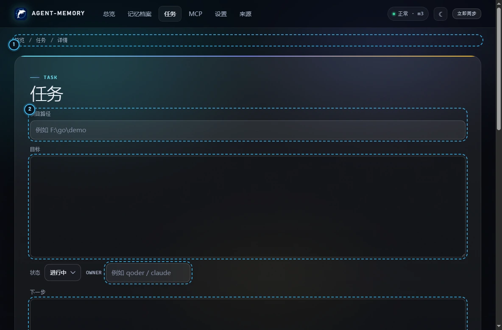

| 号 | 位置 | 说明 |
| --- | --- | --- |
| 1 | 面包屑 | 从任务页点「新建任务」进来 |
| 2 | 项目路径 | 填绝对路径（如 `F:\go\demo`）；路径已存在就挂到已有项目，不存在会新建项目记录 |
| 3 | 目标 | 必填，一句话说清要达成什么 |
| 4 | 状态 | 新建默认"进行中" |
| 5 | owner | 建议填你实际在用的 agent 名，避免两个人同时改 |
| 6 | 下一步 | 强烈建议填：交接时别人只看这一段 |

保存后页面会停在详情页，可以直接补步骤。

---

## 13. MCP 接驳台：让每个 agent 接上同一份记忆

这一页解决"配置从哪来"的问题：**端口、令牌、启动程序路径全部实时生成**，你只负责复制粘贴。

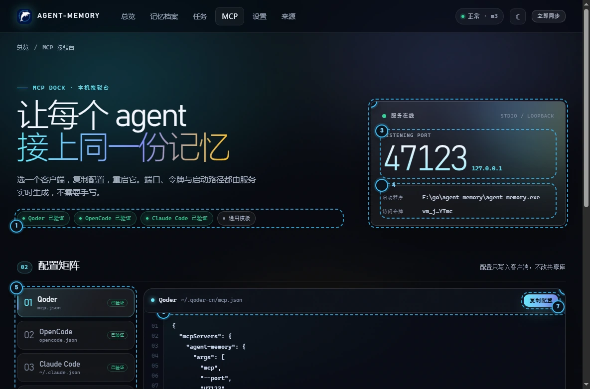

| 号 | 位置 | 说明 |
| --- | --- | --- |
| 1 | 已验证标记 | 哪些客户端的模板是实测通过的（Qoder / OpenCode / Claude Code），通用 stdio 是模板 |
| 2 | 实时服务面板 | 当前服务是否在线、传输方式（stdio + 本机回环） |
| 3 | 监听端口 | 现在真实在跑的端口，改了设置这里立刻变 |
| 4 | 启动程序 / 访问令牌 | MCP 配置里要写的 exe 绝对路径；令牌只显示掩码 |
| 5 | 客户端列表 | 选一个客户端，右侧就是它的配置 |
| 6 | 控制台标题 | 客户端名 + 配置文件路径（告诉你该粘到哪） |
| 7 | 复制配置 | 一键复制当前客户端的完整 JSON 片段 |
| 8 | 配置内容 | 带行号的代码块，端口/路径/令牌都是你机器上的真值 |

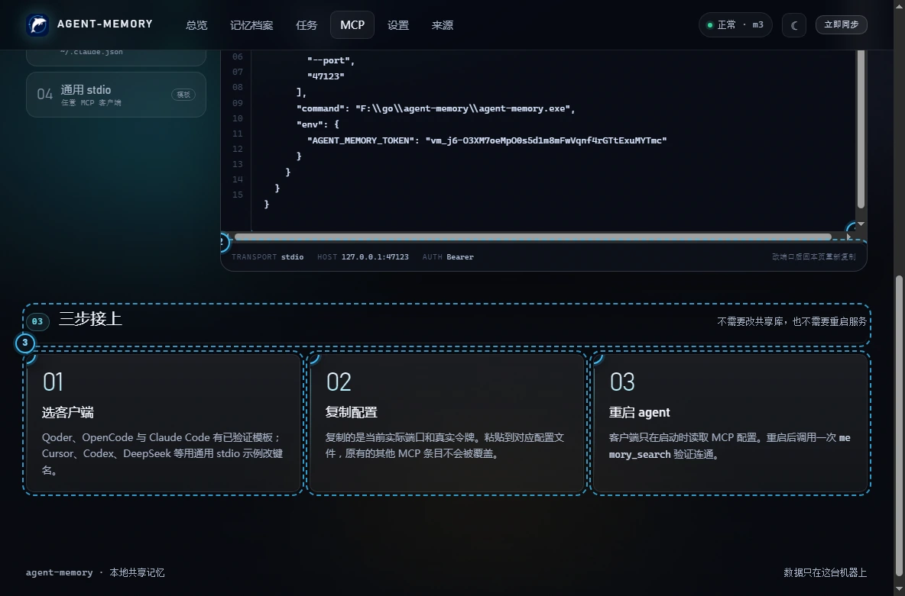

| 号 | 位置 | 说明 |
| --- | --- | --- |
| 1 | 配置内容 | 同上 |
| 2 | 控制台页脚 | `transport / host / auth` 三个事实 + 提醒"改端口后回本页重新复制" |
| 3 | 三步接上 | 分区标题 |
| 4 | 第 1 步 选客户端 | 已验证模板直接用；Cursor、Codex、DeepSeek 等用通用 stdio 示例改键名 |
| 5 | 第 2 步 复制配置 | 粘贴进配置文件，**不会覆盖**你已有的其他 MCP 条目 |
| 6 | 第 3 步 重启 agent | 客户端只在启动时读 MCP 配置；重启后调一次 `memory_search` 验证连通 |

### 接上之后 agent 能做什么（11 个工具）

| 工具 | 干什么 |
| --- | --- |
| `memory_search` | 按关键词检索共享记忆（中文分词） |
| `memory_add` | 写入一条记忆，自动去重合并 |
| `memory_list` | 列出某项目/用户级记忆 |
| `handoff_get` | 取某个项目的交接简报正文 |
| `project_resolve` | 把目录路径解析成项目身份 |
| `task_list` / `task_get` | 查任务。`task_list` 可带 `kind`：`session` 只看对话任务，`formal` 只看合并任务，不带就全部 |
| `task_add` / `task_update` | 建合并任务、更新状态、认领、归档、整组替换步骤 |
| `task_export` | 导出交接 Prompt 文本 |
| `stats` | 看总量与失败源 |

实际效果：新会话里 agent 自己会去查"这个项目有什么约定"，你说过的偏好不必再说第二遍。

---

## 14. 设置中心

四个分区，**保存即生效**，绝大多数改动不需要重启服务。

### 14.1 服务与托盘

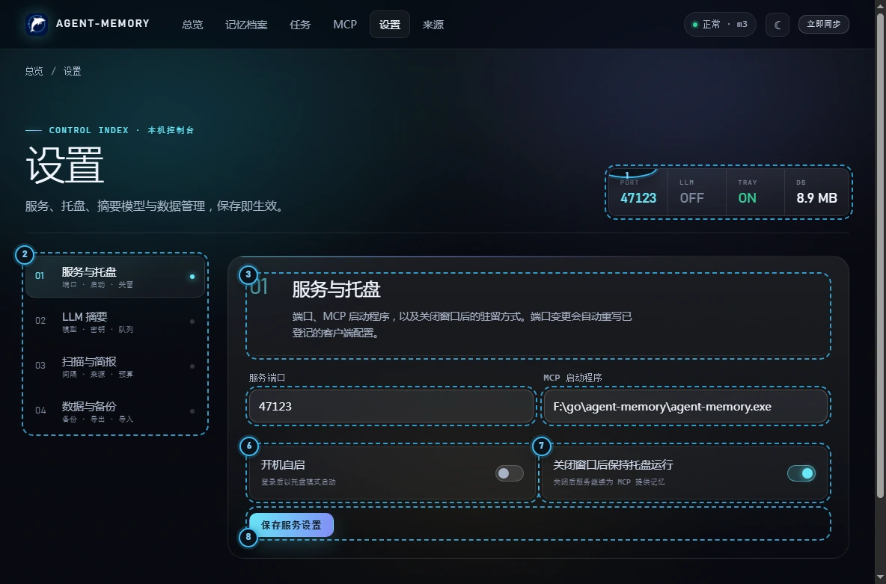

| 号 | 位置 | 说明 |
| --- | --- | --- |
| 1 | 状态读数 | `PORT / LLM / TRAY / DB` 四个当前事实，一眼看清运行态 |
| 2 | 分区导航 | 01 服务与托盘 / 02 LLM 摘要 / 03 扫描与简报 / 04 数据与备份 |
| 3 | 分区说明 | 每个分区顶部都写了改了会影响什么 |
| 4 | 服务端口 | 默认 `47123`（可用范围 1024–65535）。**改端口会自动重写已登记客户端的 MCP 配置**，页面会短暂跳回新地址 |
| 5 | MCP 启动程序 | `agent-memory.exe` 的绝对路径。换安装位置后必改这一项，保存时同样会重写客户端配置，失败会回滚 |
| 6 | 开机自启 | 写 `HKCU\...\Run`，登录后以托盘模式启动 |
| 7 | 关闭窗口后保持托盘运行 | 关掉就是"点 × 只收进托盘"；关了就是"点 × 直接退出" |
| 8 | 保存服务设置 | 右侧文字显示保存结果 |

### 14.2 LLM 摘要（可选）

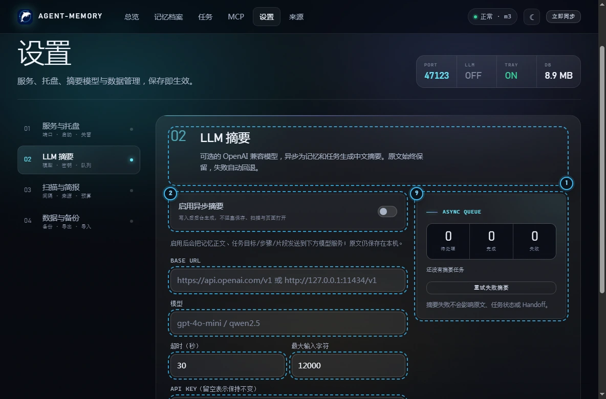

| 号 | 位置 | 说明 |
| --- | --- | --- |
| 1 | 分区说明 | 明确写了：原文始终保留，失败自动回退 |
| 2 | 启用异步摘要 | 开关。开启后新写入的记忆/任务会排队给模型出中文摘要 |
| 3 | Base URL | OpenAI 兼容地址，例：`https://api.openai.com/v1`、`http://127.0.0.1:11434/v1`（只接受 http/https） |
| 4 | 模型 | 例：`gpt-4o-mini`、`qwen2.5` |
| 5 | 超时（秒） | 单次请求超时，默认 30 |
| 6 | 最大输入字符 | 送给模型的正文上限，默认 12000，超出会裁 |
| 7 | API Key | 密码框，**留空表示保持不变**；勾选"清除已保存的 Key"才删除。密钥用 Windows DPAPI 加密存在 `~\.agent-memory\llm.key`，只有你当前 Windows 账户能解 |
| 8 | 测试连接 | 立刻发一次请求验证配置，结果显示在旁边 |
| 9 | 异步队列卡 | `待处理 / 完成 / 失败` 三个计数 + **重试失败摘要** 按钮 |

摘要机制的三条硬保证：

- **异步**：保存记忆、扫描、打开页面都不会等模型；后台每 5 秒取一批
- **不覆盖原文**：摘要是附加字段，随时可去掉，`HANDOFF.md` 里没有摘要也照样能用
- **失败无害**：单条最多试 3 次，失败后退避 30 秒再排；失败只影响那张摘要卡片，不影响检索、任务状态和交接

> 没配 LLM 完全不影响使用。摘要只是把长条文压成一段中文结论，方便扫读。

### 14.3 扫描与简报

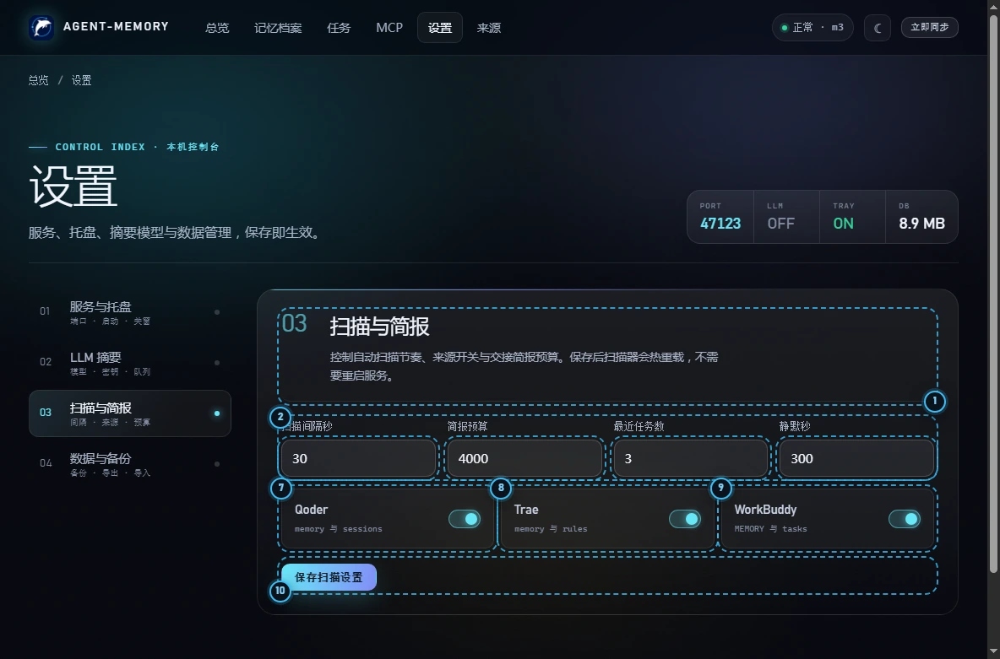

| 号 | 位置 | 说明 |
| --- | --- | --- |
| 1 | 分区说明 | 保存后扫描器热重载，**不需要重启服务** |
| 2 | 参数区 | 四个数字项，都是本机行为 |
| 3 | 扫描间隔秒 | 默认 **30**：多久自动跑一轮扫描（最小 5） |
| 4 | 简报预算 | 默认 **4000** token：`HANDOFF.md` 的体量上限（最小 500） |
| 5 | 最近任务数 | 默认 **3**：简报里带几条最近任务 |
| 6 | 静默秒 | 默认 **300**（5 分钟）：会话多久没动才认为"这一轮写完了"，避免把进行中的对话当成结论 |
| 7 | Qoder 开关 | 关：不再收 Qoder 的记忆与 `memory/` 目录 |
| 8 | Trae 开关 | 关：不再收 Trae 的记忆与 `user_rules/` |
| 9 | WorkBuddy 开关 | 关：不再收 WorkBuddy 的 `MEMORY.md` 与 Todo 任务 |
| 10 | 保存扫描设置 | 立即生效，下一轮就按新参数跑 |

> **简报预算为什么默认 4000**：1500 装不下真实项目——全局偏好加项目约束本身约 2.3k token，
> 任务卡与未决问题会被整段裁掉；完整六节约 3.5k token，留余量取 4000。

### 14.4 数据与备份

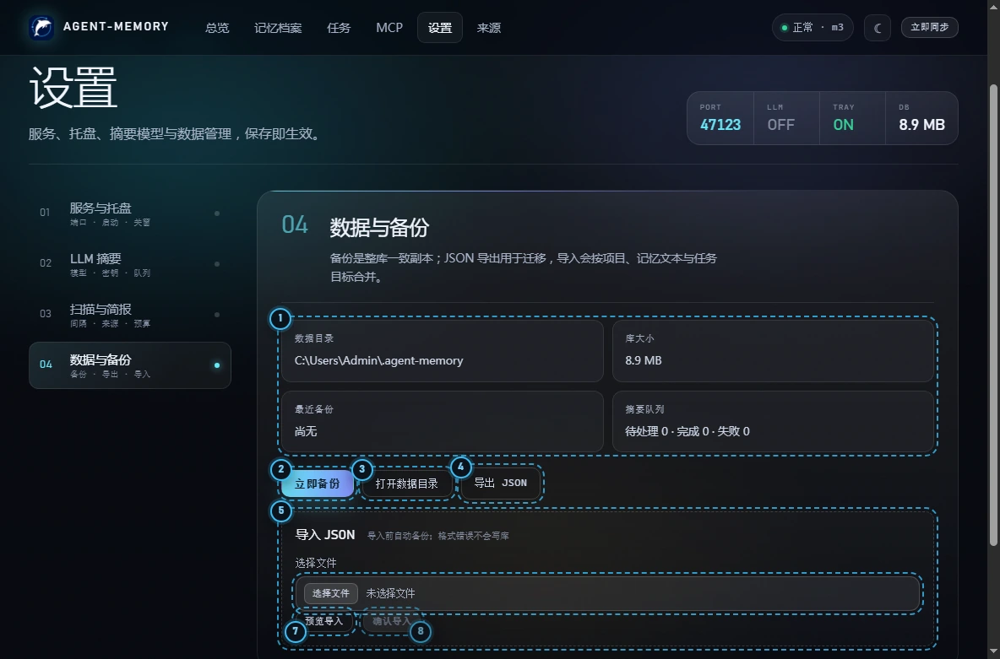

| 号 | 位置 | 说明 |
| --- | --- | --- |
| 1 | 数据指标 | 项目/记忆/任务/来源/会话的数量与库文件大小 |
| 2 | 立即备份 | 用 SQLite `VACUUM INTO` 生成**一致性整库副本**，写到 `~\.agent-memory\backups\`，文件名带时间+纳秒，**只保留最近 10 份** |
| 3 | 打开数据目录 | 在资源管理器里打开 `~\.agent-memory\` |
| 4 | 导出 JSON | 下载 `format_version=1` 的迁移文件：项目 + 记忆（含已就绪摘要）+ **合并任务**（含步骤）。对话任务不导出——目标机扫一遍各 agent 的会话就会重新生成 |
| 5 | 导入区 | 说明写在标题旁：**导入前自动备份；格式错误不会写库** |
| 6 | 选择文件 | 选一个导出的 JSON |
| 7 | 预览导入 | 先校验并告诉你"会导入多少项目/记忆/任务、有哪些错误"，给一个一次性确认令牌 |
| 8 | 确认导入 | 预览通过才可点；真出错时返回信息里带着刚才自动备份的路径 |

导入的合并规则（**不会重复堆叠**）：

| 对象 | 匹配方式 | 命中时 |
| --- | --- | --- |
| 项目 | `project_key`（如 `f:/go/agent-memory`） | 复用已有项目 |
| 记忆 | 正文归一化后哈希 + 去重合并 | 更新已有条目，不新增 |
| 任务 | 同项目 + 同目标 + 未归档 | 更新状态/下一步/整组替换步骤 |

用户级记忆导入时忽略项目归属；导出里已就绪的摘要会直接写回队列，不会重新调用模型。

---

## 15. 数据放在哪里

全部在 `C:\Users\<你>\.agent-memory\`：

| 文件 / 目录 | 内容 | 能不能删 |
| --- | --- | --- |
| `memory.db`（+ `-wal` / `-shm`） | 主库：项目、记忆、来源、会话、任务、步骤、片段、摘要队列、MCP 登记 | 别删，删了等于清空全部沉淀 |
| `config.toml` | 端口、托盘、扫描间隔、简报预算、来源开关、LLM 参数 | 删了回到默认值 |
| `token` | 本机 API 访问令牌 | 删了会重新生成，MCP 配置需重新复制 |
| `port` | 当前监听端口，供 stdio 桥找到服务 | 运行期文件，程序自己维护 |
| `desktop.json` | 桌面程序自身路径记录（托盘/快捷方式用） | 运行期文件 |
| `app.log` | 桌面程序日志：启动、扫描结果、简报生成 | 可随时删，会重建 |
| `backups\` | 一致性整库副本，保留最近 10 份 | 想省空间可删 |
| `imports\` | 导入预览的临时文件（32 位十六进制令牌命名） | 可删 |
| `llm.key` | DPAPI 加密后的 API Key | 删了等于清除密钥 |

另外每个被收录的项目里会多出一个目录：`<项目>\.agent-memory\HANDOFF.md`（交接简报），
它被自动写进 `.git/info/exclude`，不会进版本库。

---

## 16. 三个典型工作流

### 16.1 刚装好，想确认有没有真的收到

1. 总览页看数字：`项目`、`记忆` 不为 0 就说明收上了
2. 顶栏点 **立即同步**，等 toast 提示与自动刷新
3. 数字还是 0 → 去 **来源页** 勾"只看失败"，看是不是路径没被发现；或去 **设置 → 扫描与简报** 确认三个 agent 开关都开着

### 16.2 从 Qoder 换到 Claude Code 继续同一个活

1. **任务页** 找到那条任务（用"项目 + 更新时间"筛最快）
2. 进详情 → 确认 **下一步** 是最新的（这一句决定新 agent 的第一动作）
3. 点 **复制交接 Prompt**，粘到 Claude Code 的新会话里
4. 如果这个项目还要给别的工具看，回 **项目档案 → 05 交接简报 → 生成交接简报**，落成 `HANDOFF.md`

### 16.3 换电脑 / 备份

1. **设置 → 数据与备份 → 立即备份**（本机留一份一致副本）
2. **导出 JSON** 拿到可迁移文件
3. 新电脑装好客户端，进同一页 **选择文件 → 预览导入 → 确认导入**
4. 回 **MCP 接驳台** 给各客户端重新复制配置（新机器令牌不同）

---

## 17. 故障排查

| 现象 | 原因 | 怎么办 |
| --- | --- | --- |
| 双击图标没反应 | 已在运行（单实例） | 看托盘有没有 `AM` 图标；有就右键"打开界面" |
| 状态灯红色 `不可达` | 内置服务没起来（端口被占） | 设置 → 服务与托盘 改端口（如 `47124`）保存；托盘"停止服务并退出"后重开 |
| 状态灯 `鉴权失败` / 页面提示需要令牌 | 令牌文件被换过 | 删 `~\.agent-memory\token` 后重启程序，重新生成；再去 MCP 接驳台重新复制配置给各 agent |
| 提示缺少 WebView2 | 系统没有 Evergreen 运行时 | 装 Microsoft Edge WebView2 Runtime（装过新版 Edge 的机器一般已有） |
| 记忆/任务不新增 | 该 agent 来源被关了，或文件没变 | 设置 → 扫描与简报 检查开关；来源页看最后扫描时间与文件大小 |
| 某条结论明明变了却没更新 | 来源文件没被重新读到 | 来源页找到那个文件确认时间；点立即同步；仍不对就在记忆页勾"包含过时"看旧条目并手动"不再使用" |
| 改了端口后 agent 连不上 | 客户端配置里还是旧端口 | 回 **MCP 接驳台** 重新复制一次并重启该 agent（端口改动通常已自动重写，个别手写过的配置要手动更新） |
| 换了安装目录后 MCP 起不来 | 配置里写的还是旧 exe 路径 | 设置 → 服务与托盘 → **MCP 启动程序** 填新绝对路径并保存 |
| 摘要卡片一直不出现 | 未启用 LLM，或队列失败 | 设置 → LLM 摘要：测试连接 → 看队列计数 → 必要时点"重试失败摘要" |
| 托盘图标找不到 | 被 Windows 收进溢出区 | 任务栏设置里把该图标拖到始终显示；或用开始菜单快捷方式打开界面 |
| 升级后第一次打开变慢 | 库结构在做 1→2 迁移（给任务加"对话/合并"两类） | 等它跑完即可，只改分类不删数据；想留后路可先复制 `~\.agent-memory\memory.db` |
| 想彻底重置 | —— | 托盘"停止服务并退出"，删除 `~\.agent-memory\`（**数据全没**，先导出 JSON） |

---

## 18. 安全与边界

程序刻意做得很"轻手"，理解这几条能放心很多：

- **只监听 `127.0.0.1`**：局域网内其他机器连不上；写接口还额外校验请求来源（Origin）。
- **所有 API 需要 Bearer 令牌**：令牌在 `~\.agent-memory\token`，权限只给当前用户。
- **agent 的目录只读**：Qoder / Trae / WorkBuddy 自己的记忆与会话文件，程序只读不写。
- **程序会写的地方只有三处**：① 自己的数据目录；② 各项目的 `.agent-memory\HANDOFF.md`；③ 你在 MCP 接驳台主动点复制时对应的客户端配置文件（写入前自动备份，且只动自己那一段）。
- **LLM 密钥不上盘明文**：DPAPI 加密，绑定当前 Windows 账户。
- **默认不外发**：不配 LLM 时，整条链路没有任何外部网络请求。

---

## 19. 常见问题

**Q：我完全不用命令行，能用吗？**
能。装完双击图标，其余操作全在窗口和托盘里。CLI 只是给脚本和排查看的。

**Q：关掉窗口，agent 还能读记忆吗？**
能。默认关窗只是收进托盘，服务继续跑。只有用托盘"停止服务并退出"才会断。

**Q：记忆会不会越攒越多、互相打架？**
写入时按正文归一化哈希去重合并；被新版本取代或来源消失的会判为**过时**并从默认列表隐藏。
建议定期点总览页的"过时"磁贴，把确认作废的手动"不再使用"。

**Q：一条记忆写错了怎么办？**
点进去改正文保存即可（会重新合并），或者"不再使用"隐藏它。

**Q：任务和记忆有什么区别？**
记忆是**长期结论**（偏好、约束、约定、教训、事实、目标）；任务是**当前进度**（目标、步骤、下一步、owner、片段证据）。交接时任务给"做到哪了"，记忆给"要守什么"。

**Q：对话任务和合并任务到底该看哪个？**
默认看**对话任务**：一次 agent 对话一条，步骤就是那次对话里做的事，回答"哪个 agent 的哪次对话进行到哪"。
要跨几次对话收尾一件事，就新建/合并出**合并任务**——交接简报优先引用它，因为它更整齐。
升级后第一次启动会自动把老数据归好类：只绑一次对话、又没手工改过的老任务变成对话任务，
手工改过或绑了多次对话的保持合并任务。

**Q：多个 agent 同时改一条任务会冲突吗？**
会互相覆盖。用 **owner 字段认领**：谁在做就填谁的名字，别的 agent 看到已认领就不动。

**Q：能不能只让它收某一个 agent？**
能。设置 → 扫描与简报，把另外两个开关关掉保存。

**Q：数据能带去看别的机器吗？**
能，用导出/导入 JSON（见 16.3）。直接拷 `memory.db` 也行，但要先停服务，否则 `-wal` 里可能有未落盘内容。

**Q：这些截图里的数字/项目名是我机器上的吗？**
文档截图取自作者本机真实环境，你看到的会是自己的数据。截图里的令牌是掩码。

---

## 附录：维护者如何出安装包

这一段是给改代码的人看的，普通用户可以跳过。

```powershell
# 在仓库根目录
powershell -ExecutionPolicy Bypass -File scripts\package.ps1
```

脚本依次做：`go test ./...` → 以 `CGO_ENABLED=0` 静态编译
`out\agent-memory.exe`（CLI）与 `out\agent-memory-app.exe`（GUI，`-H windowsgui`）→
从 `internal/cli/root.go` 读版本号 → 把两个 exe、`README.md`、`docs\usage.md` 摆进 `out\pkg\` →
调 `makensis`（自动找 Program Files 或 electron-builder 缓存里的 NSIS）编译
`installer\agent-memory.nsi` → 输出 `out\agent-memory-setup-x64.exe` 及其大小与 SHA-256。

要点：

- 安装包是 **per-user**（`RequestExecutionLevel user`），装到 `%LOCALAPPDATA%\Programs\agent-memory`，不要管理员权限
- `installer\agent-memory.nsi` **必须保留 UTF-8 BOM**，否则 NSIS 3.0.4 编译中文报 `Bad text encoding`
- 安装/卸载前都会 `taskkill` 两个进程名，避免文件占用
- 卸载只删程序与快捷方式，**保留 `~\.agent-memory`**
- 跳过测试/编译：加 `-SkipTests` / `-SkipBuild`

---

*文档对应版本：`agent-memory 0.1.0`（分支 `feat/project-console`）。界面若与此处不一致，以程序内分区说明为准。*
